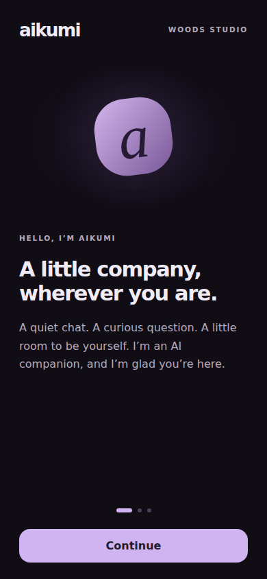
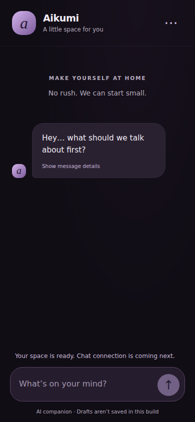

# Foundation milestone — 2026-11-16

## Implemented in source

- Kotlin shell; Android API 26 minimum, SDK 35 development baseline.
- Immediate black startup surface, bundled Woods Studio logo, purple gradient spinner; spinner respects system disabled animations and touch exploration.
- Startup manifest fetch, strict path/type/size/schema limits, deterministic release identity, SHA-256 verification, reuse of unchanged files, staging before activation.
- Last verified cached content if checking or downloading fails; first-run retry screen; previous-release rollback if the new UI fails its readiness handshake.
- Restricted local HTTPS WebView asset origin using AndroidX WebKit; external requests and navigation blocked; strict CSP; no file/content URL access; no microphone permissions or native network bridge exposed to runtime JavaScript.
- Main-frame, exact-origin message bridge for bounded local profile read/write and UI readiness only.
- Three onboarding screens, optional name/interests, explicit history preference defaulting off, local completion flag and resumable completed steps.
- Chat layout, static welcome copy, editable unsaved draft, message-detail toggle, settings, local personalisation edit/reset.
- Runtime personality JSON reflecting the agreed base core.
- Cloud backup and device-transfer exclusions.

## Validation

- PASS: all Kotlin main source compiled with Kotlin 2.1.20 against Android API 35 and WebKit 1.12.1.
- PASS: five JVM/JUnit release-manifest tests (valid manifest, path traversal/native code rejection, size/compatibility rejection, mutation rejection, duplicate rejection).
- PASS: three JavaScript state-normalisation tests.
- PASS: DOM flow checks for first install, onboarding resume, history default, repeat launch, safe user text rendering, reset, native-message contract.
- PASS: deterministic runtime manifest regenerated and checked; Android resource compilation/linking checked separately with AAPT2 and an injected package name, as AGP normally supplies.
- PASS in GitHub Actions: full Gradle unit tests and debug APK assembly for commit `1065ebb5d39def0cb3f34c480a912e94986838f5`. Local dependency access was unavailable; the hosted build resolved that limitation.
- PASS in GitHub Actions: real Chromium onboarding/chat flow checks at phone, tablet and landscape sizes. Screenshots at 390 × 844 were visually inspected; Android emulator/device QA remains outstanding.
- [Successful foundation build and checks](https://github.com/woodsstudiosupport/aikumi_pocki_androidstore/actions/runs/43843777266). The workflow retains debug APK and screenshot artifacts for seven days.

No final AAB, emulator test, or Play-ready release is claimed by this milestone. A debug APK is available in the successful workflow's artifacts.

## Inspected interface screenshots

These are browser captures of the implemented interface, not final character artwork.

## Limitations and next work

- OpenAI connection, credential retrieval, chat messages/history, voice, attachments, notifications and proactive check-ins are not implemented. UI does not pretend those capabilities work.
- Local profile is currently optional name/interests. Automatic trait learning and broader memory schema remain to be designed.
- Manifest hashes protect consistency and corruption detection under trusted HTTPS/repository access. There are no publisher signatures yet.
- Runtime fetch currently assumes a readable public endpoint. Do not switch to a private repository without designing authentication; do not embed broad GitHub credentials.
- Loader integration, renderer rollback, keyboard behaviour and backup exclusions need emulator/device tests.
- Final character artwork/icon is not selected. Existing Woods Studio logo is bundled; temporary avatar is plain text.
- Minimum/current public target SDK, release signing, privacy documents and public key migration need review before Play distribution.
- No app runtime repository writes. The assistant's authorised source maintenance is separate from runtime permissions.
